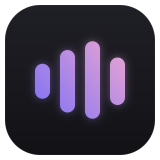
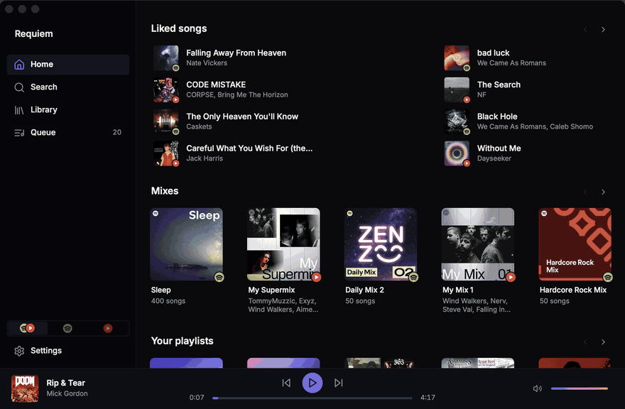
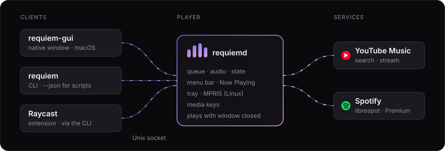
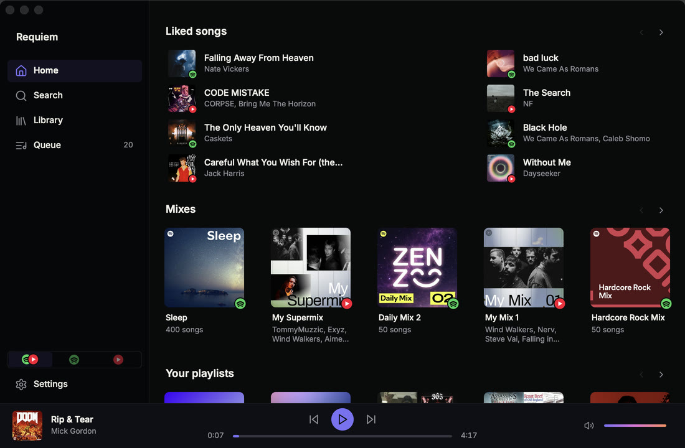
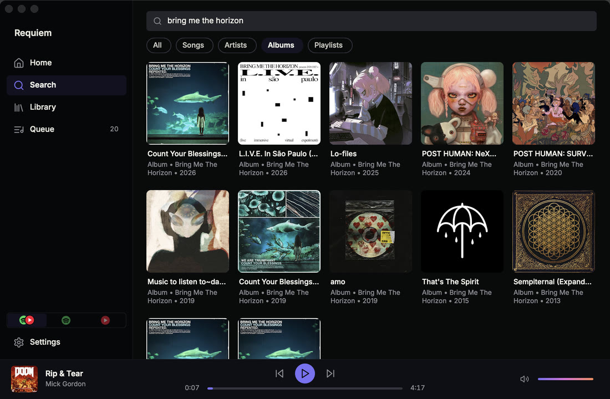
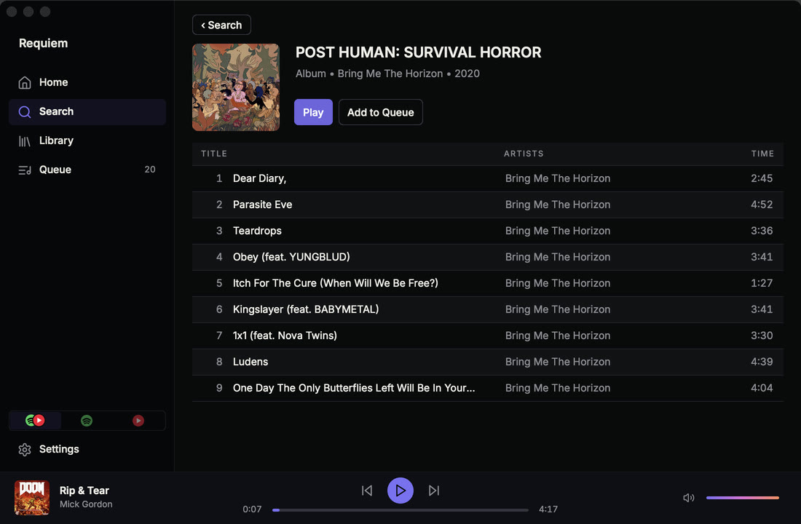
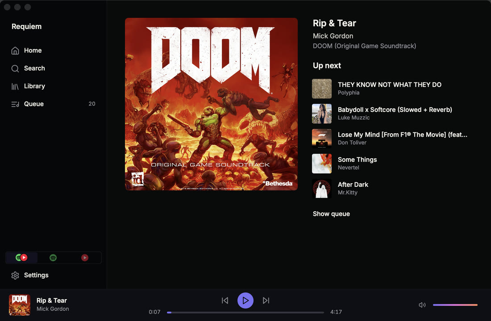

<p align="center">
  
</p>

<h1 align="center">Requiem</h1>

<p align="center">
  <b>A lightweight music app that uses about as many resources as a dead person 💀</b><br>
  Native desktop client for <b>YouTube Music</b> and <b>Spotify</b>, built to stay open all day.
</p>

<p align="center">
  <a href="https://github.com/blutarche/requiem/releases/latest"></a>
  <a href="#install"></a>
  <a href="#license"></a>
  
</p>

<p align="center">
  
</p>

## Why

The big music apps ship a web browser to show you a list of songs. YouTube Music has no desktop app at all. Requiem is a native player you can leave running permanently and forget about:

| | Memory | CPU |
| --- | --- | --- |
| Player (`requiemd`), playing | 20–24 MiB | 0.7–0.8% (under 0.01% paused) |
| Window (`requiem-gui`), open | 18–20 MiB | about 0.3% |

Measured on an Apple Silicon Mac (physical footprint). Close the window and the music keeps playing from the menu bar.

## Features

- **Two services, one library.** Home, search and your Library mix YouTube Music and Spotify, each cover badged with its service. Show both or just one.
- **Native, not a webview.** AppKit on macOS, GTK 4 on Linux, Rust underneath. No Electron, no Chromium.
- **Lives in the menu bar.** Play/pause and skip from the menu bar icon; it publishes Now Playing and answers the media keys.
- **Keyboard first.** Cmd+K (Ctrl+K on Linux) opens a command palette, and the everyday actions have shortcuts.
- **Scriptable.** A CLI drives the running player, with `--json` output for scripts, and a [Raycast extension](integrations/raycast) is built on it.
- **Linux too.** The same window on GTK 4, and a player with a tray icon and MPRIS, so `playerctl`, media keys and desktop widgets control it.
- **Remembers where you were.** Queue, the resume point and volume survive restarts.
- **Updates itself** on macOS from signed GitHub releases.
- **No telemetry.** The developer runs no servers and receives nothing. See [PRIVACY.md](PRIVACY.md).

<p align="center">
  
</p>

Requiem is three programs. `requiemd` is the player: it plays audio, owns the queue and keeps running when the window closes. `requiem-gui` is the window, and `requiem` is the CLI. They talk over a per-user Unix socket. More in [docs/architecture.md](docs/architecture.md).

## Install

### macOS

Download `Requiem-<version>.dmg` from the [latest release](https://github.com/blutarche/requiem/releases/latest), open it and drag Requiem onto Applications. Then open Requiem from Applications.

The first time you open Requiem, macOS blocks it because it isn't notarized: click **Done**, then in **System Settings → Privacy & Security** click **Open Anyway**.

### Linux

On x86_64 or aarch64, the release has the window, the player and the CLI as `requiem-<version>-linux-<arch>.tar.gz`. The window needs GTK 4.8 or later. Install ALSA's and GTK's libraries, unpack the tarball for your machine, put the programs on your `PATH`, and add the window to your applications menu:

```sh
sudo apt install libasound2t64 libgtk-4-1   # Ubuntu 24.04 and later; libasound2 on Debian 12 and older Ubuntu
sudo dnf install alsa-lib gtk4               # Fedora
tar -xzf requiem-<version>-linux-$(uname -m).tar.gz
cd requiem-<version>-linux-$(uname -m)
install -D -m 755 -t ~/.local/bin requiem requiemd requiem-gui
install -D -m 644 -t ~/.local/share/applications io.github.blutarche.Requiem.desktop
cp -r icons ~/.local/share/
```

Then open Requiem from the applications menu, or run `requiem-gui`. If the shell can't find it, open a new terminal: most distributions add `~/.local/bin` to `PATH` once it exists. The window and `requiem --connect` start `requiemd` when it isn't running; closing the window leaves the music playing, and the tray icon's Show Window brings it back. Requiem doesn't update itself on Linux: install a newer tarball the same way.

### From source

Needs Rust and libopus. See [docs/development.md](docs/development.md).

```sh
cargo build --release   # target/release/{requiemd,requiem-gui,requiem}
```

## Quick start

Search and playback of YouTube Music work without signing in. Open Requiem, press Cmd+F, type a song and press Return, then double-click a result to play it. On Linux, use Ctrl where these say Cmd and Alt where they say Option.

| Keys | Does |
| --- | --- |
| Return / Cmd+Return | Play the selected result / add it to the queue |
| Space | Play or pause |
| Left / Right | Seek 5 s |
| Cmd+Left / Cmd+Right | Previous / next track |
| Cmd+1 … Cmd+4 | Home, Search, Library, Queue |
| Cmd+K | Command palette |
| Cmd+Z | Undo a replaced or cleared queue |
| Cmd+Q | Close the window; the music keeps playing |
| Option+Cmd+Q | Quit and stop the music |

From a terminal:

```sh
requiem --connect     # then type commands, one per line:
search night drive    # numbered results
play 1                # play the first
add 3                 # queue the third
vol 40
```

Every shortcut, the Home and Library pages, and the queue: [docs/usage.md](docs/usage.md). Every CLI command and the JSON output: [docs/cli.md](docs/cli.md).

## Accounts

Signing in adds your own music to Home and the Library.

- **YouTube Music** signs in with a session copied from a browser where you are signed in. The copied cookie is your Google sign-in, so read [docs/youtube-music.md](docs/youtube-music.md) before you do it.
- **Spotify** signs in with a code at <https://www.spotify.com/pair> and needs Premium. It plays through [librespot](https://github.com/librespot-org/librespot); Spotify doesn't allow unofficial players, so your account could be suspended. See [docs/spotify.md](docs/spotify.md).

## Screenshots

<table>
  <tr>
    <td></td>
    <td></td>
  </tr>
  <tr>
    <td></td>
    <td></td>
  </tr>
</table>

## Documentation

- [Using Requiem](docs/usage.md): the window, Home and Library, keyboard
- [The CLI](docs/cli.md): commands, scripting, JSON output
- [YouTube Music](docs/youtube-music.md): signing in with a browser session, what is kept, the risks
- [Spotify](docs/spotify.md)
- [How it fits together](docs/architecture.md): the player, the window, the CLI, Linux tray and MPRIS
- [Updates](docs/updates.md): how self-update works and what it sends
- [Development](docs/development.md): building, bundling, snapshots, the footprint gate
- [Privacy](PRIVACY.md)

## Contributing

Issues and pull requests are welcome. Build and test with:

```sh
cargo build
cargo test
scripts/perf-check.sh   # the footprint gate; plays audio at 5% volume
```

Footprint is a feature: a change that makes the player or window noticeably heavier needs a reason.

## Notes

- Requiem is an unofficial client. It is not affiliated with or endorsed by Spotify, YouTube, or Google.
- YouTube Music playback is anonymous and ad-free. That breaks YouTube's Terms of Service; you use it at your own risk, and YouTube may break it at any time.

## License

Requiem is MIT OR Apache-2.0 ([LICENSE-MIT](LICENSE-MIT), [LICENSE-APACHE](LICENSE-APACHE)). The app bundle also ships:

- [Inter](https://rsms.me/inter/) — SIL Open Font License 1.1;
- [Lucide](https://lucide.dev) icons — ISC;
- [libopus](https://opus-codec.org) — BSD-3-Clause.

Their license texts are in `Requiem.app/Contents/Resources/licenses/`.
